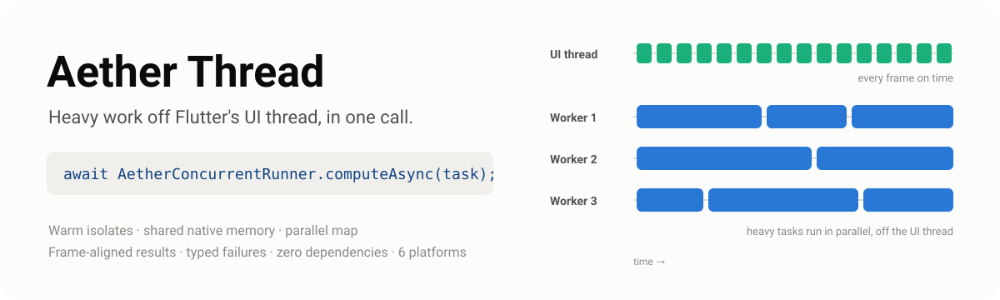
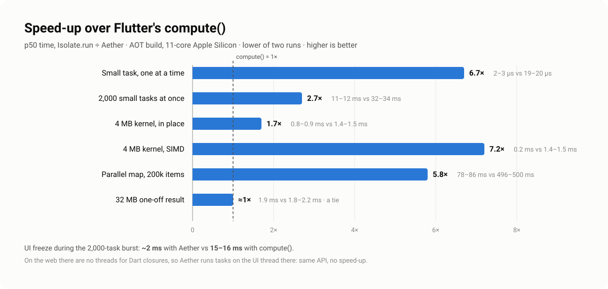
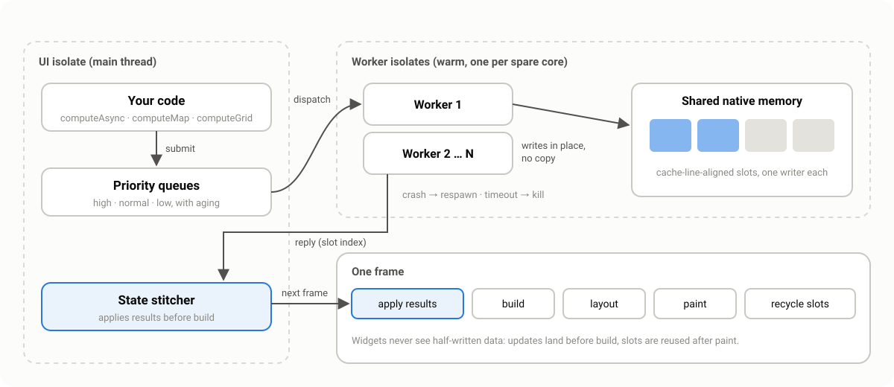

# Aether Thread



Move heavy work off Flutter's UI thread without writing isolate code.

Aether Thread keeps a pool of worker isolates warm for the life of your app,
shares bulk numeric data with them through native memory that is never
copied, and applies results at the start of the next frame, so widgets never
see half-written state. You call one function; there are no `Isolate`,
`SendPort` or `ReceivePort` calls in your code.

```dart
await AetherConcurrentRunner.initialize();

final primes = await AetherConcurrentRunner.computeAsync(
  countPrimesTask(3000000),
);
```

- **Zero dependencies.** Only the Flutter SDK. Native memory is allocated
  through `dart:ffi` directly.
- **Warm workers.** Started once and respawned automatically if one crashes
  or is killed. By default, two cores stay free for Flutter's UI and raster
  threads.
- **Parallel map, progress, one-shot.** `computeMap` spreads a list across
  every worker, `computeWithProgress` streams progress to the UI, and
  `computeOnce` hands large one-off results over without copying.
- **Shared memory.** `computeGrid` and `startContinuous` work on native-backed
  `Float32List` slots in place, with no copy in either direction.
- **Frame-aligned results.** Grid results land in the frame's transient
  callback phase, before build.
- **Typed failures.** Every way a task can fail is a subclass of the sealed
  `AetherFailure`, delivered to the task's future and, in a frame, to a global
  `onFailure` callback.
- **Priorities, aging, timeouts, cancellation, stats** and DevTools timeline
  events per task.

Platforms: Android, iOS, macOS, Windows, Linux and **web**. The same code
compiles and runs everywhere; see [On the web](#on-the-web) for what
changes there.

## Install

```yaml
dependencies:
  aether_thread: ^0.1.0
```

## Quick start

```dart
import 'package:aether_thread/aether_thread.dart';

Future<void> main() async {
  WidgetsFlutterBinding.ensureInitialized();
  await AetherConcurrentRunner.initialize(
    onFailure: (failure) => debugPrint('Aether: $failure'),
  );
  runApp(const MyApp());
}
```

### 1. Run a function on a worker

```dart
int Function() sumTask(List<int> values) => () => values.fold(0, (a, b) => a + b);

final total = await AetherConcurrentRunner.computeAsync(
  sumTask(bigList),
  priority: AetherPriority.high,
  timeout: const Duration(seconds: 2),
);
```

The future completes as soon as the result arrives; it never waits for a
frame.

> **Write task builders as top-level (or static) functions**, as above. In
> Dart a closure written inside a method captures that method's whole scope,
> including `this` and things like `BuildContext` that cannot cross isolates.
> If that happens you get an `AetherUnsendableTask` failure straight away,
> naming the object that could not be sent, and the worker is unaffected.

### 2. Process a list on every core

```dart
double score(Photo photo) => /* heavy per-item work */;

final scores = await AetherConcurrentRunner.computeMap(photos, score);
```

The list is split into chunks (about four per worker), results come back in
order, and if any item fails the rest are cancelled.

### 3. Report progress

```dart
AetherProgressTask<int> importTask(List<String> rows) => (report) {
  for (var i = 0; i < rows.length; i++) {
    parse(rows[i]);
    report((i + 1) / rows.length);
  }
  return rows.length;
};

await AetherConcurrentRunner.computeWithProgress(
  importTask(rows),
  onProgress: (fraction) => setState(() => progress = fraction),
);
```

Reports are throttled to about 60 per second; the final 1.0 always gets
through.

### 4. One big result

```dart
final pixels = await AetherConcurrentRunner.computeOnce(decodeTask(bytes));
```

`computeOnce` runs on a fresh isolate and hands its result over with
`Isolate.exit`, without copying, so it matches `compute()` on large one-off
results while keeping Aether's timeouts, cancellation and typed failures.
For small or frequent tasks, `computeAsync` is far faster.

### 5. Transform shared memory in place

```dart
void scale(Float32List slot, AetherPayload payload) {
  for (var i = 0; i < payload.floatCount; i++) {
    slot[i] *= 2;
  }
}

await AetherConcurrentRunner.computeGrid(
  kernel: scale,
  nodeCount: 50000,                               // × nodeStride floats
  prepare: (slot, payload) => slot.setAll(0, input),  // UI isolate, before
  onApplied: (slot, payload) => setState(() {         // UI isolate, in a frame
    result = Float32List.fromList(slot.sublist(0, payload.floatCount));
  }),
);
```

The kernel writes straight into memory the UI isolate can see. `onApplied`
runs at the start of the next frame and is the only place to read the slot:
it is recycled right after that frame.

Slots are `Float32List`s, but the same memory can be viewed as other types
without copying: `slot.asFloat32x4()` (SIMD, four floats per operation),
`asInt32()`, `asUint32()`, `asFloat64()` and `asBytes()`.

```dart
void scale(Float32List slot, AetherPayload payload) {
  final lanes = slot.asFloat32x4();
  final two = Float32x4.splat(2);
  for (var i = 0; i < payload.floatCount ~/ 4; i++) {
    lanes[i] = lanes[i] * two;
  }
}
```

### 6. Run a simulation every frame

```dart
final grid = await AetherConcurrentRunner.startContinuous(
  kernel: stepParticles,   // (previous, next, payload) on a worker
  nodeCount: 100000,
  seed: seedParticles,     // writes the first state
);

CustomPaint(
  painter: AetherSlotPainter(
    notifier: grid.notifier,
    pointCount: 100000,
    color: Colors.indigo,
  ),
);

await grid.stop();
```

Two slots are double-buffered: the worker writes the back slot while the UI
reads the front slot, and they swap at the start of each frame. Neither side
waits for the other. `AetherSlotPainter` passes the native-backed list
straight to `Canvas.drawRawPoints`, with no Dart-side copy.

## Failures

| Failure | When |
|---|---|
| `AetherTaskException` | The task threw. Carries the error and the worker's stack trace. |
| `AetherWorkerCrash` | The worker isolate died (for example an uncaught async error). It is respawned. |
| `AetherTaskTimeout` | The task ran past its timeout. The worker is killed and respawned. |
| `AetherTaskCancelled` | Cancelled through an `AetherCancelToken`. Not sent to `onFailure`. |
| `AetherUnsendableTask` | The closure captured something that cannot cross isolates. |
| `AetherUnsendableResult` | The result cannot cross isolates. |
| `AetherCapacityExceeded` | Every slot is busy and `maxPendingGrid` calls are already waiting. |
| `AetherPoolShutdown` | `dispose()` ran first. Not sent to `onFailure`. |
| `AetherWorkerInitFailure` | `workerInit` threw, or a worker could not start. |

```dart
try {
  await AetherConcurrentRunner.computeAsync(task);
} on AetherFailure catch (failure) {
  switch (failure) {
    case AetherTaskTimeout(): showRetry();
    case AetherTaskCancelled(): break;
    default: report(failure);
  }
}
```

**Cancellation:** pass an `AetherCancelToken`. A queued task fails at once.
A running task's result is discarded when it finishes, or, with
`token.cancel(hard: true)`, its worker is killed and respawned.

## On the web

The web has no threads that can run Dart closures: `dart:isolate` does not
work there, and Web Workers cannot receive closures. So on the web Aether
switches, automatically, to a backend that runs tasks **on the UI thread**:

- **The API is identical.** `computeAsync`, `computeMap`, `computeOnce`,
  `computeWithProgress`, `computeGrid`, `startContinuous`, priorities,
  aging, cancellation, progress and typed failures all work, so one code
  base runs on every platform without `kIsWeb` branches.
- **Tasks run one per event-loop turn**, so the browser can draw a frame and
  handle input between two tasks. Split big jobs (`computeMap` does this for
  you) to keep pages responsive.
- **There is no speed-up.** A long synchronous task blocks the page while it
  runs, exactly as if you had called it directly. In the example app, the
  particle simulation ran at the same speed in both modes in Chrome (25.5
  vs 26.7 fps at 100k particles), and drawing, not computing, was the limit
  (35 ms per frame in CanvasKit).
- **Timeouts and hard cancels abandon a task**: its future fails at once and
  its result is discarded, but code that is already running cannot be
  stopped. Grid and continuous kernels are the exception: their failure
  arrives when the kernel finishes, so a slot is never reused while it is
  still being written. Worker crashes and unsendable closures cannot happen
  on the web.
- Slots are ordinary heap memory, so `ContiguousMemoryBuffer.attach` throws
  `UnsupportedError` there.

Both the JavaScript and the WebAssembly (`--wasm`) builds are supported.

## Several runtimes

`AetherConcurrentRunner` is a static front for one default `AetherRuntime`.
Create runtimes directly when two parts of an app need different settings,
or to inject one into code under test:

```dart
final imaging = await AetherRuntime.start(
  config: const AetherConfig(pool: AetherPoolConfig(workerCount: 2)),
);
final thumbs = await imaging.computeMap(files, makeThumbnail);
await imaging.dispose();
```

## Configuration

Every setting is optional.

```dart
await AetherConcurrentRunner.initialize(
  config: const AetherConfig(
    pool: AetherPoolConfig(
      workerCount: null,                         // processors − 2
      taskTimeout: Duration(seconds: 30),        // null disables
      agingInterval: Duration(milliseconds: 250),
      enableTimeline: true,
    ),
    slotCount: 8,
    slotStrideFloats: 65536,                     // rounded to 64 bytes
    nodeStride: 4,
    maxPendingGrid: 64,
    maxPendingFrameUpdates: 64,
  ),
  workerInit: loadLookupTables,                  // runs once per worker
);
```

- **Aging:** a task's effective priority rises one level for each
  `agingInterval` it waits, so low-priority work cannot starve.
- **Nested calls:** `computeAsync` called from a worker runs inline, so a
  task can use helpers that call the runner without deadlocking the pool.
- **Lifecycle:** timeout clocks pause while the app is in the background (so
  healthy tasks are not killed when the OS suspends the workers). With no
  frames being drawn, grid results are applied straight away instead of
  waiting, and continuous grids stop stepping until the app is visible again,
  so nothing spins in the background. The runner disposes itself on
  `AppLifecycleState.detached`. Native memory also
  has a finalizer, so a hot restart does not leak it.
- **Stats:** `AetherConcurrentRunner.stats()` gives queue depths, busy and
  idle workers, respawns, and p50/p99 submit-to-result latency.

## Benchmarks



Measured on 2026-10-11 on an 11-core Apple Silicon Mac (9 workers, the
default), AOT-compiled (`benchmark/roundtrip_benchmark.dart`), against
`Isolate.run`, which is what Flutter's `compute()` uses on native platforms.
Ranges cover two runs. "Max stall" is the longest gap in a 1 ms timer on the
main isolate; about 2 ms is the timer's own noise floor on macOS.

| Workload | Aether | `Isolate.run` / `compute()` |
|---|---|---|
| Small task, one at a time (p50) | **2–3 µs** | 19–20 µs |
| 2,000 small tasks at once (wall) | **11–12 ms** | 32–34 ms |
| …max main-thread stall during that | **~2 ms** | **15–16 ms** |
| 4 MB kernel (p50) | **0.8–0.9 ms** in place | 1.4–1.5 ms copying in and out |
| 4 MB kernel with `asFloat32x4()` SIMD (p50) | **0.2 ms** | — |
| 32 MB one-off result (p50), `computeOnce` | **1.9 ms** | 1.8–2.2 ms (a tie) |
| 200k CPU-heavy items, `computeMap` vs one isolate | **78–86 ms** | 496–500 ms |

Caveats, measured too:

- **Plain `computeAsync` copies its reply**, so a 32 MB result takes 6–8 ms
  that way. Use `computeOnce` for big one-off results.
- **A map that saturates every worker can still stall the main thread**
  (9–15 ms here), because the CPU is simply full. Pass a smaller
  `workerCount`, or schedule such work outside animations.
- **Core count matters.** In a 4-core Linux container (2 workers by default)
  `computeMap` was 1.9× faster than one isolate rather than 6×, and
  `computeOnce` took 4.0 ms against `Isolate.run`'s 3.1 ms.

Example app, profile build, same Mac, 120 Hz display (`example/`, run with
`--dart-define=AETHER_AUTOBENCH=true`):

| Particles | Simulated on an Aether worker | Simulated on the UI thread |
|---|---|---|
| 100,000 | 119.7 fps | 120.2 fps |
| 300,000 | **120.5 fps** | **10.5 fps** |

At 300k particles about 1 frame in 9 still runs past the 8.3 ms budget on
the raster (GPU) side, because drawing 300k points is itself expensive. Phones
are slower than this Mac, so the gap appears at lower counts there.

## What it cannot do

| | |
|---|---|
| Guarantee 120 Hz or sub-millisecond latency | No library can; it depends on the device and OS scheduler. The numbers above are measurements, not promises. |
| Allocate nothing at all per task | Every port message and `Future` allocates. Bulk data is never copied, and the per-task overhead is a small fixed number of objects regardless of data size. |
| Interrupt a worker stuck in a native FFI call | `Isolate.kill` takes effect only when Dart code runs again. |
| Send closures that capture unsendable objects | Reported as `AetherUnsendableTask`. |
| Run in parallel on the web | No threads can run Dart closures there; the web backend keeps the API but runs tasks on the UI thread. |

## How it works



One native block holds a 64-byte header row per slot followed by the slots
themselves, each aligned to a cache line. Every isolate builds its own
`Float32List` view over the same address. A slot is written by exactly one
isolate at a time: ownership passes to a worker with the task message and
back with the reply (or with the worker's confirmed exit), so no locks or
atomics are needed. `SPEC.md` has the full functional specification and
data-flow diagram.

## License

MIT
